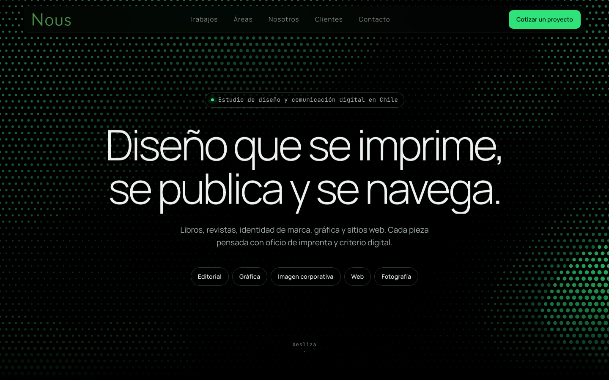

# Nous Diseño · sitio web

Sitio portafolio de **Nous Diseño**, estudio de diseño y comunicación digital en Chile. Estático (HTML + CSS + JS), rápido y sin base de datos. Marca en negro y verde, tipografía Manrope y JetBrains Mono.



## Qué incluye
- Portada con fondo generativo de puntos (halftone en canvas).
- Escena de scroll con la ampolleta, fija y minimalista.
- 25 proyectos, cada uno con su propia página (`trabajos/<id>.html`) y galería con zoom.
- Secciones Nosotros, Áreas, Clientes y Contacto.
- Formulario de cotización con validación (envía por correo o a un servicio de formularios).
- Accesible: respeta `prefers-reduced-motion`, navegación por teclado, textos sin viudas.

## Correrlo en local
```bash
python3 -m http.server 8765    # o: npx serve .
# abrir http://localhost:8765
```
Los ES modules no cargan con `file://`; hay que servir la carpeta.

## Editar el contenido
Todo el contenido vive en `content/`, separado del diseño.

| Qué | Dónde |
|---|---|
| Proyectos (título, categoría, cliente, texto, imágenes, orden) | `content/proyectos/<id>.json` |
| Contacto y formulario | `content/sitio.json` |
| Textos de portada y Nosotros | `index.html`, bajo el comentario `EDITAR` |

```bash
npm install          # una sola vez (instala sharp)
npm run imagenes     # optimiza fotos de content/nuevos/<id>/ a 400 y 1200 px
npm run build        # regenera js/data.js, js/config.js y trabajos/*.html
```
Guía paso a paso para no técnicos: [`LEEME-EDITAR.md`](LEEME-EDITAR.md).

### Formulario de cotización
Sin configuración, abre el correo del visitante con la cotización escrita. Para que llegue directo, crea un endpoint gratis (Formspree, Web3Forms) y pega la URL en `content/sitio.json` → `contacto.formulario`; luego `npm run build`.

## Estructura
```
index.html            portada y secciones
css/                  estilos (styles.css, project.css)
js/                   main, halftone, zoom, works, nav, quote, config.js y data.js (generados)
content/              fuente del contenido (JSON)
tools/                build.mjs, add-images.mjs, plantillas
trabajos/             páginas de proyecto (generadas)
assets/               imágenes optimizadas y marca
fonts/, vendor/       tipografías y GSAP 3.12.5 + ScrollTrigger (copias locales)
```

## Publicarlo
Es un sitio estático: sirve cualquier hosting gratuito (Cloudflare Pages, Netlify, GitHub Pages). Sin paso de build obligatorio, solo subir la carpeta. Al definir `url` en `content/sitio.json` el build genera `sitemap.xml` y `robots.txt`.

## Próximas mejoras
- **Easter egg del monito:** el personaje con boina y pincel que corre y escribe "Nous Diseño", escondido como sorpresa (no como intro ni fondo).
- Panel `/admin` (Decap CMS) para que Nous edite proyectos sin tocar archivos.
- Mover los textos de portada y Nosotros a `content/`.
- Dominio `ndsno.cl` y publicación automática desde este repo.
- Instagram en el contacto y confirmación de permisos de cada cliente.

## Créditos
Diseño y desarrollo: [Nikolas](https://github.com/xSempiternus). Tipografías bajo licencia OFL (`fonts/`).
